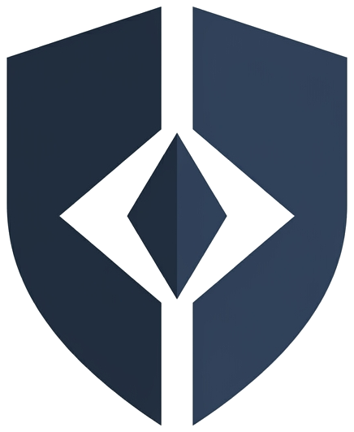

<p align="center">
  <p align="center">
    
  </p>
  <h1 align="center"><b>sentinel</b></h1>
  <p align="center">
    Local neural asset screening, image scrubbing, and pre-upload verification for Roblox
    <br />
    <a href="https://github.com/3xjn/sentinel/releases"><strong>Releases →</strong></a>
  </p>
</p>

`sentinel` runs offline in pure Rust to catch moderation risks in images, text, scripts, and place files before upload. It records evidence, thresholds, content hashes, and bounding boxes in a JSON ledger.

**Screen every asset locally before it hits Roblox:**

- Detect text, QR codes, and visual policy risks with [neural image scanning](#scanning)
- Customize or add ONNX classifiers without recompiling via [modular models](#models)
- Redact flagged regions while protecting kept pixels with [protected scrubbing](#scrubbing)
- Validate staged bundles and emit Luau policy tables with [port verification](#port-verification)

<details>
<summary><b>Table of Contents</b></summary>

- [At a Glance](#at-a-glance)
- [Installation](#installation)
- [Models](#models)
- [Scanning](#scanning)
- [Scrubbing](#scrubbing)
- [Port Verification](#port-verification)
- [Limits](#limits)

</details>

---

## At a Glance

```bash
# Install the default ONNX models
sentinel models install

# Scan a directory or file (exits 1 if any asset is blocked)
sentinel scan ./assets --json

# Inspect or generate a customizable models.toml
sentinel models list
sentinel models init
```

<details>
<summary>Example <code>scan --json</code> output</summary>

```json
{
  "assets": [
    {
      "path": "assets/scene.jpg",
      "sha256": "0410490fec8f754399d288b61af7b96d0f636355598c2a03649abcb97bf10019",
      "kind": "image",
      "flag_count": 1,
      "max_score": 0.75451005,
      "blocked": true,
      "category_scores": {
        "sexual_nudity": 0.75451005
      },
      "flags": [
        {
          "category": "sexual_nudity",
          "detector": "marqo_nsfw",
          "score": 0.75451005,
          "threshold": 0.3,
          "evidence": "marqo_nsfw probability 0.754510",
          "rect": [0, 0, 1024, 576]
        }
      ]
    }
  ],
  "total_assets": 1,
  "blocked_assets": 1,
  "total_flags": 1
}
```

</details>

---

## Installation

Download a prebuilt binary from [GitHub Releases](https://github.com/3xjn/sentinel/releases) (`sentinel-windows-x86_64.exe`, `sentinel-linux-x86_64`, `sentinel-macos-aarch64`, `sentinel-macos-x86_64`), or install from source with a current stable Rust toolchain:

```bash
cargo install --git https://github.com/3xjn/sentinel
```

Or build locally:

```bash
cargo build --release --bin sentinel
```

---

## Models

All inference runs locally in pure Rust via `ocrs` and `rten` — no C/C++ runtimes or cloud moderation calls. Download the default models once after installing:

```bash
sentinel models install
```

| Model | Role | Source |
| --- | --- | --- |
| `text-detection.onnx` | OCR text region detection | [ocrs DBNet](https://ocrs-models.s3-accelerate.amazonaws.com/text-detection.onnx) |
| `text-recognition.onnx` | OCR line recognition | [ocrs CRNN](https://ocrs-models.s3-accelerate.amazonaws.com/text-recognition.onnx) |
| `open-nsfw.onnx` | Photorealistic NSFW classifier | [OpenNSFW](https://huggingface.co/bluefoxcreation/open-nsfw/resolve/main/open-nsfw.onnx) |
| `marqo-nsfw-384.onnx` | 2D / stylized & photo NSFW ViT | [Marqo NSFW-384](https://huggingface.co/KanariKanaru/nsfw-image-detection-384-onnx/resolve/main/model.onnx) |
| `clip-vision.onnx` | Zero-shot Roblox ToS screening | [CLIP ViT-B/32](https://huggingface.co/Xenova/clip-vit-base-patch32/resolve/main/onnx/vision_model.onnx) |

CLIP zero-shot screening covers **drugs & paraphernalia**, **alcohol**, **tobacco/vaping**, **gambling**, **graphic gore/corpses**, **realistic firearms/weapons**, **self-harm**, **hate symbols**, **obscene gestures**, **nudity/suggestive content**, and **offsite/QR indicators** out of the box.

Model discovery checks `SENTINEL_MODEL_DIR`, then `%LOCALAPPDATA%\sentinel\models` on Windows (`$HOME/.local/share/sentinel/models` elsewhere), then `./models`. Run `sentinel models init` to write `models.toml` (or set `SENTINEL_MODELS_CONFIG`) to toggle models, tune `[clip]` (`temperature`, `safe_margin`, `disabled_prompts`), or add extra `[[classifiers]]` entries without recompiling.

---

## Scanning

```bash
sentinel scan ./assets ./badge.png --json
sentinel scan ./assets --fast --only-flagged --jsonl
sentinel scan ./assets --category sexual_nudity --fast --only-flagged
sentinel scan ./assets --no-models --json
sentinel scan ./game --profile balanced --threshold offsite_link=0.25
```

- **Inputs:** Recursively discovers PNG, JPEG, WebP, Lua/Luau, JSON, TXT, and Roblox place/model files across CPU cores (skipping `.git`, `target`, `node_modules`, and unreadable system paths).
- **Profiles:** `high-recall` (default) favors human review; `balanced` raises all thresholds by `0.20`.
- **Categories:** `offsite_link`, `gore_violence`, `sexual_nudity`, `profanity_slurs`, `regulated_goods`, `unfiltered_text_input`. Pass `--category <name>` (repeatable) to restrict scanning and skip unrelated detectors (e.g., `--category sexual_nudity` skips OCR, QR, and CLIP).
- **Fast mode:** `--fast` skips multi-scale opaque-image tiling and evaluates full frames only (~0.15s/image warm) for large directory or drive-wide sweeps.
- **Flagged-only & live streaming:** `--only-flagged` omits clean files from `--json` / `--jsonl` output while keeping totals; `--jsonl` streams each result as one JSON line as soon as it finishes, and multi-file scans print live progress (`done/total`) to `stderr`.
- **Lightweight mode:** `--no-models` skips OCR, ONNX classifiers, and CLIP while still running QR decoding, PNG metadata, text rules, and visual heuristics.
- **Exit codes:** `0` clean, `1` review flags or verification violations, `2` input or processing error.

---

## Scrubbing

```bash
sentinel scrub sheet.png -o clean.png --rect 20,40,180,60 --keep 150,40,20,20
```

`scrub` redacts `--rect` regions (`x,y,width,height`) while preserving every pixel inside `--keep` rectangles. The default `--mode auto` samples the two-pixel clean perimeter, clears regions with at least half transparent samples, and otherwise inpaints from clean cardinal neighbors (`transparent` and `inpaint` force either strategy). Output must be PNG.

---

## Port Verification

```bash
sentinel verify-port ./ports/catalog --cloud-manifest ./ports/catalog/cloud-assets.json --json
sentinel emit-policy audit.json -o Policies.luau
```

- `verify-port` checks catalog or standalone staged port bundles (`audit.json`, `staging-report.json`, `plan.json`, `metadata.json`, `AssetManifest_staged/*.luau`, `assets/`) for unsafe visible-text blanking, node coverage, page hashes, transparent blank regions, repair variants, PNG references, and optional cloud hash freshness.
- `emit-policy` generates a Luau module starting with `--!optimize 2` containing `hiddenNodeIds`, `preservedControls`, `retainedContainers`, and `scrubbedRects`.

---

## Limits

- These checks assist human review and do not guarantee Roblox moderation approval.
- Text rules, OCR, and zero-shot vision models can produce false positives on stylized art or miss heavily obfuscated content.
- Place scans extract readable spans; compressed Roblox chunks are not fully parsed.
- Sprite-sheet crops use alpha connectivity, so touching sprites or opaque sheets can merge.
- PNG text decompression is bounded to 8 MiB per chunk.
